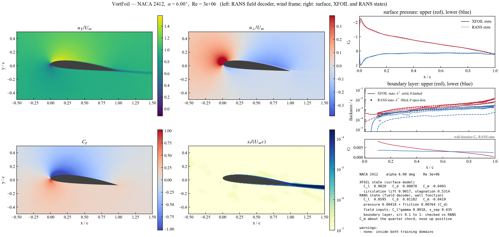

**English** | [한국어](https://github.com/SHRhie/VortFoil/blob/main/README_ko.md)

# VortFoil

[](https://doi.org/10.5281/zenodo.23336871)

See [`MODEL_CARD.md`](MODEL_CARD.md) for intended use and limits, and [`CHANGELOG.md`](CHANGELOG.md) for release notes.

Code, trained weights, sealed result files and figures accompanying **"VortFoil: A
Vortex-Panel-Informed Neural Operator for Steady Airfoil Flow Prediction."**

VortFoil embeds classical vortex-panel aerodynamics inside a neural operator's forward pass. A
network predicts a rate function whose closed-form anti-derivative is the surface vortex sheet;
a linear projection imposes the discrete Kutta condition exactly. Surface pressure, the
circulation lift `Cl^γ`, the quarter-chord moment, the stagnation point and the trailing-edge
edge velocity are panel-method readouts of that sheet, not separately learned quantities. A
second bank of heads predicts the integral boundary layer. The two deployed force coefficients
are *not* pure sheet readouts: profile drag is a ridge-fitted closure on the predicted
trailing-edge state, and the deployed lift is the circulation readout plus a ridge-fitted
viscous-decambering correction read from that same state. A geometry-agnostic field decoder
reconstructs the 2D RANS field, conditioned on the sheet's circulation and the boundary-layer
trailing-edge state rather than on an external solver. **This repository ships one confirmed
surface model and the field decoder conditioned on it**, together with the XFOIL-conditioned
decoder it is compared with. There is no geometry-only coefficient regressor, and no XFOIL or CFD process is
launched at inference time in any of the three stages. That is a statement about external
solver calls, not about fitting and not about linear algebra: both force closures are empirical
fits frozen at deployment, and the field pathway's physics paint still carries deterministic
panel solves inside the model.

See [`paper/abstract.md`](paper/abstract.md) for the manuscript abstract. The manuscript is the source of
record; the abstract here is a mirror and is never edited in place.

> **Status.** Version 2.0.0 accompanies the manuscript *VortFoil: A Vortex-Panel-Informed Neural Operator
> for Steady Airfoil Flow Prediction* (S.-H. Rhie, G. Kim, S. Lim, J. Lee), prepared for *Computer Methods in Applied
> Mechanics and Engineering*. It was released on 2026-10-13 on GitHub and PyPI and is archived on Zenodo:
> [10.5281/zenodo.23336872](https://doi.org/10.5281/zenodo.23336872) (this version; all versions: [10.5281/zenodo.23336871](https://doi.org/10.5281/zenodo.23336871)). The license is GPL-3.0-or-later (see *License* below).

## Layout

```
code/             the two smoke tests and the path helper (vortfoil_paths.py)
code/model/       OP1 (sheet) and OP2 (boundary layer) operator definitions, ADA-F machinery,
                  and the drag-closure trainer
code/field/       the field decoder's state provider, its training/eval drivers and the field scorers
code/reproduce/   measurement scripts behind the reported numbers
code/figures/     figure generators for the manuscript
weights/          the 13 shipped weight files (see table below)
data/eval/        XFOIL evaluation targets (not training data)
results/          sealed records the manuscript numbers are copied from
evaluation_runs/  sealed per-case metrics of the XFOIL-conditioned decoder runs (the field scorers' reference)
figures/          figures as they appear in the manuscript, plus their saved numbers
paper/            the manuscript abstract
```

Full per-file purposes, the `VORTFOIL_*` path-override environment variables, and the naming
convention for research-tree artifacts that are *not* shipped here are all in
[`code/README_code.md`](code/README_code.md) — read it before running anything in `code/`.

## The model

1. **Sheet operator (OP1)** — `weights/op1_supervised_eps0.50.scr_bd128.npz`. Conditioning
   vector `[CST16, sin α, cos α, log Re] ∈ R^19` → ADA-F vortex-sheet strength γ on a fixed
   241-node loop (branch 128×3 / trunk 128×2, N_m = 24, Kutta projection). Every surface
   quantity is a readout of γ: Cp, the circulation lift Cl^γ = 2∮γ ds, Cm (pressure integral), the stagnation point
   (the unique sign change of the tangential velocity), and u_e at the trailing edge.
2. **Boundary-layer operator (OP2)** — `weights/op2_m325_BT.npz`. Four ADA-F heads (θ, δ* on
   both surfaces, 121-node per-surface uniform x/c grid, N_m = 16), trained on 325,370 gated
   XFOIL boundary-layer rows. It does not consume the sheet.
3. **Drag closure** — `weights/cd_closure_poly2.npz`, implemented in
   `code/model/staged/common/wake_ode_tf.py` (default `closure="fitted_poly2"`): log10 Cd =
   wᵀφ(log θ_TE, H_TE, u_e,TE), ten ridge-fitted coefficients on the training deck, clipped to
   `[1e-4, 0.1]`. It replaces a marched Squire–Young route (see Results below).
4. **Lift closure** — `weights/lift_closure_poly2.npz`, implemented in
   `code/model/staged/common/lift_closure_tf.py` (`cl_closed_tf`): Cl = Cl^γ +
   wᵀφ(Cl^γ, θ_u,TE, θ_l,TE, δ*_u,TE, δ*_l,TE, u_e,TE), a degree-2 polynomial in the predicted
   trailing-edge state (28 ridge-fitted coefficients on the same 325,370 training rows, frozen;
   upper and lower surfaces enter separately). It is the viscous-decambering correction to the
   sheet's circulation lift; the deployed Cl is this closed value. The field decoder below still
   consumes the uncorrected Cl^γ.
5. **Field decoder** — `weights/field_decoder_f0cm_s1.npz`, the deployed operator-conditioned
   decoder: a geometry-agnostic RANS field decoder (five-layer width-248 non-residual trunk,
   four-band Fourier features, a PointNet shape latent z ∈ R^16 over the real surface point cloud,
   physics-paint inputs; ≈305k parameters) trained on 780 AirfRANS k–ω SST cases, the 800-case
   training split less 20 held out for validation. Its two conditioning inputs come from OP1 and OP2
   through `code/field/state_provider.py`, not from an XFOIL call: the paint circulation scale
   Cl^γ (uncorrected) and the separation scalar `s_sep = clip((max(H_TE^u, H_TE^l) − 2)/8, 0, 1)`
   (`s_rule="teH"`), the larger of the two per-surface trailing-edge shape factors, used for its
   training rows and for every evaluation of it. The comparison decoder,
   `weights/field_decoder_f0a_s2.npz`, has the same architecture and recipe and is trained and
   evaluated on XFOIL's inputs (the XFOIL-conditioned decoder). Of each decoder's three training
   runs, the deployed one has the lowest mean of the four standardized channel MSEs on the
   trainer's 20-case validation holdout: 0.00262 for operator-conditioned run 1
   (`results/f0cm_holdout_rescore.json`) and 0.00372 for XFOIL-conditioned run 2
   (`results/f0a_holdout_rescore_20260930.jsonl`); the non-deployed runs are shipped too
   (`results/field_deployed_weights.json`, `selection.*`). `weights/airfrans_surface_tokens.npz`
   (surface point tokens for the shape latent) and `weights/airfrans_train_stats.npz` (output
   normalization) are inputs the decoder needs, not separate models.

## Weights

| file | role | sha256 (first 12) |
|---|---|---|
| `op1_supervised_eps0.50.scr_bd128.npz` | OP1 sheet operator | `3bc4baaba1cc` |
| `op2_m325_BT.npz` | OP2 boundary-layer operator | `a21ce5116b0b` |
| `cd_closure_poly2.npz` | drag closure coefficients (`fitted_poly2`) | `1e37b6e3dfb4` |
| `lift_closure_poly2.npz` | lift closure coefficients (`cl_closed_tf`) | `788f7c73efb2` |
| `field_decoder_f0a_s0.npz` | field decoder, XFOIL-conditioned, run 0 | `d90b88a5757e` |
| `field_decoder_f0a_s1.npz` | field decoder, XFOIL-conditioned, run 1 | `118face2a9e8` |
| `field_decoder_f0a_s2.npz` | field decoder, XFOIL-conditioned, run 2 (deployed) | `1440f8f4dbd3` |
| `field_decoder_f0cm_s0.npz` | field decoder, operator-conditioned, run 0 | `e1da6228e827` |
| `field_decoder_f0cm_s1.npz` | field decoder, operator-conditioned, run 1 (deployed) | `5e72da181372` |
| `field_decoder_f0cm_s2.npz` | field decoder, operator-conditioned, run 2 | `fed72563ca1e` |
| `op2_d500k_previous.npz` | the previously released boundary-layer operator (d500k; not in the deployed chain) | `3c9e8d031fd4` |
| `airfrans_surface_tokens.npz` | shape-latent surface point tokens | `cd27519b76dc` |
| `airfrans_train_stats.npz` | field-decoder output normalization | `3da1cefe69d2` |

Hashes are the full `sha256sum` output in `weights/SHA256SUMS`, which lists bare file names; verify
with `(cd weights && shasum -a 256 -c SHA256SUMS)`.

## Install

**The application and the `vortfoil` command (Windows, macOS, Linux).** Install with [uv](https://docs.astral.sh/uv/), which also provides the Python:

1. Install uv, once:
   - Windows: `winget install --id=astral-sh.uv -e`
   - macOS: `brew install uv`
   - Linux: `curl -LsSf https://astral.sh/uv/install.sh | sh`
2. Install VortFoil: `uv tool install --python 3.12 --managed-python vortfoil`. To install from a copy of this repository instead: `uv tool install --python 3.12 --managed-python ./VortFoil`. `--managed-python` makes uv use its own Python, which includes Tk for the window; a system Python, such as Ubuntu's, may lack it.
3. Type `vortfoil` in a terminal. The application window opens (see [Desktop application](#desktop-application)).

The same command has these subcommands; each takes `--help`:

- `vortfoil view`: one airfoil in one window, from the command line;
- `vortfoil predict` and `vortfoil sweep`;
- `vortfoil about` and `vortfoil selfcheck`.

`uv tool upgrade vortfoil` updates it. On Linux the window needs a desktop session (a display).

### Two commands: `vortfoil` and `vortfoil_exp`

- `vortfoil` runs the paper's 2D models: the surface model (XFOIL state) and the RANS field decoder (RANS state) for one
  section, in the application window and in the subcommands above. Its window has no 3D wing (`vortfoil app --experimental` is refused).
- `vortfoil_exp` is the same with one addition in the application window, the **experimental** quasi-3D wing (the box
  "3D wing" next to the section's name): a classical nonlinear lifting line (Phillips and Snyder, 2000) that carries VortFoil
  sections in either state, for straight to moderately swept planforms of any size, with kinks, dihedral and NACA, UIUC or
  file sections. It is not part of the paper's validated claims. `vortfoil_exp view`, `predict`, `sweep`, `about` and `selfcheck` are
  `vortfoil`'s. From a checkout: `python code/vortfoil_app.py --experimental`.
  A gray line below the Section model row says what the inputs must respect: the speeds that keep every strip inside each
  state's training Reynolds range (they follow the strips' chords: the table, Scale x and Strips), the strips' incidence limits, whether the speed you
  typed fits, and that the RANS state was trained on NACA 4/5-digit sections only when a section is not one. To put a UIUC section
  on the wing, pick it in the Airfoil box (search its list) and press **Selected row(s)** or **All rows** in the Geometry window.

### Uninstall

1. Remove the program.
   - A uv install: `uv tool uninstall vortfoil`.
   - A pip install: `pip uninstall vortfoil`.
   - An environment made for a checkout: `conda env remove -n vortfoil`, or delete its venv folder; then delete the repository folder.
2. Delete what the application keeps: the UIUC list, the sections you opened and its log. They are in `%LOCALAPPDATA%\vortfoil` on Windows and in `~/.cache/vortfoil` on macOS and Linux.
3. Delete a launcher made with `--shortcut`: **VortFoil** on the Windows desktop, or `~/.local/share/applications/vortfoil.desktop` on Linux (with `--experimental`: **VortFoil (experimental)**, or `vortfoil-exp.desktop`). macOS has none.
4. If no other uv tool uses them, remove uv's Python and its download cache: `uv python uninstall 3.12`, then `uv cache clean`.
5. If you installed uv only for VortFoil, remove it last, after step 4 (which needs uv):
   - Windows: `winget uninstall --id=astral-sh.uv -e`
   - macOS: `brew uninstall uv`
   - Linux: `rm ~/.local/bin/uv ~/.local/bin/uvx`

**As a Python library**, in your own environment:

```bash
pip install vortfoil            # from PyPI
pip install -e .                # from this repository (a fresh environment: it installs TensorFlow)
```

In an environment that already has a pinned TensorFlow, install without touching it:
`pip install --no-deps -e .`. Verified on Python 3.10 with TensorFlow 2.10 (CPU and an NVIDIA RTX
4060 Ti) and with TensorFlow 2.18 / Keras 3.12; all three reproduce the recorded scores.

```python
import vortfoil, numpy as np

vf = vortfoil.load_model()                       # mode="graph", device="cpu"
r  = vf.predict(cst=cst16, alpha=4.0, Re=1e6)    # or coords=(P,2) airfoil points
r.cl, r.cd, r.cm                                 # deployed lift, drag, moment
r.cl_gamma                                       # circulation lift alone, 2 * oint gamma ds
r.cp, r.stagnation, r.ue_te, r.theta_te, r.dstar_te
r.x_cp, r.theta, r.dstar                         # Cp abscissae; BL thicknesses [upper, lower] at x/c = vortfoil.BL_X

vf.sweep(cst16, np.linspace(-4, 12, 33))         # one shape, many incidences, one batch
vf.predict(coords=xy, alpha=np.linspace(-4, 12, 33), Re=1e6)   # the same from coordinates (one fit)
vf.gradients(cst=cst16, alpha=4.0, of="cl")      # reverse-mode d/dCST16 through the whole chain
vortfoil.about()                                 # weights, recipe, populations, scores, limits
```

Given coordinates instead of CST coefficients, the shape is fitted to the 16-parameter form first
and the incidence is measured from the fitted chord line, so a rotated or scaled section is handled
correctly; the fit residual and the rotation are returned in `result.info`.

Command line:

```bash
vortfoil about
vortfoil predict --cst 0.17,0.16,... --alpha 4 --Re 1e6
vortfoil sweep   --coords section.dat --alpha-range -4,12,17
vortfoil selfcheck --data data/eval/holdout_targets.npz     # reproduces the recorded scores
```

Tests: `VORTFOIL_EVAL_DATA=data/eval/holdout_targets.npz pytest -q tests/`.

### Input range

The surface model was trained on XFOIL solutions at incidences of −10° to 18° and Reynolds numbers of 5×10⁴ to 10⁷
(incompressible, Ncrit 7, closed trailing edges) and evaluated at −4° to 12° and 2×10⁵ to 3×10⁶. Outside the training
range, `predict()`, `sweep()` and `gradients()` issue a `vortfoil.RangeWarning` and flag the rows in
`result.info["outside_training_range"]`. They also warn when coordinates deviate from their 16-parameter fit by more
than 0.5% chord or have a trailing-edge gap above 1% chord.

### Flow field for any section

The installed package carries the RANS field decoder (its deployed run) and runs it through `vortfoil view` and the
application. From a checkout, `code/field/predict_field.py` runs it for any section, incidence and Reynolds number, from
the coordinates alone, with no AirfRANS files and no XFOIL:

```bash
python code/field/predict_field.py --coords section.dat --alpha 4 --Re 3e6 --out field.npz --png field.png
python code/field/predict_field.py --naca 23012 --alpha 8 --Re 4e6 --out field.npz
```

It writes u, v, p and ν_t on a grid in AirfRANS units (chord 1 m, air, U∞ = Re·ν) and normalized (u/U∞, v/U∞, C_p,
ν_t/(U∞c)), together with the operator state it used (C_l^γ, s_sep). The default grid spans −0.5 to 1.5 by −0.5 to 0.5
chords at 0.005 chord in the wind frame (freestream along +x). `--points` takes your own points, and `--frame body` uses
the chord frame.

The decoder was trained on AirfRANS k–ω SST fields of NACA 4- and 5-digit sections at −5° to 15° and Re 2×10⁶ to 6×10⁶.
It issues a `FieldRangeWarning` outside that range.

**Other airfoil families: much less accurate.** Ten UIUC sections of other families were computed with the AirfRANS protocol (k–ω SST, OpenFOAM v2112, inside the ranges above) and scored with the deployed metric. The decoder's errors were 1.5 to 80 times its NACA test level per section, and 26 times on average for u_x.

- The errors are largest near the wall but also large off the body.
- Sections close to a NACA shape stayed within the test tail: RAE 2822 1.5 times, NACA 64₂-415 2.8 times and DU 84-132V 2.9 times.
- The others were far off: FX 63-137 7.7 times, Clark Y 10 times, NLF(1)-0416 13 times, SD7003 15 times, E387 26 times, AH 79-100C 51 times and S1223 80 times.

The shape-code distance check did not flag any of them, so it is not a family detector. Every section that is not given as a NACA designation (`--naca`, a NACA airfoil in the viewer or the application) therefore gets a `FieldRangeWarning` saying so; read such a field as indicative. The surface results come from the separate surface model and are not affected.

Validation on the 200 AirfRANS test cases (`code/field/validate_predict_field.py`, `results/predict_field_validation.json`):

- **The deployed evaluation's inputs:** the script reproduces the recorded per-case errors.
- **The case's 441-node section coordinates alone:** its mean errors are 0.99, 0.99, 1.07 and 1.03 times the deployed
  decoder's (u_x, u_y, p, ν_t).
- **A sparse 161-node section, which it resamples:** errors on the RANS mesh rise near the wall (u_y 3.8 times) because
  most mesh nodes lie inside the first cells of the boundary layer. On a 0.01-chord grid, the sparse- and dense-input
  predictions differ by 0.3% to 6% of the decoder's own test error.

Give dense coordinates (at least 441 points) when the near-wall field matters.

### Wall pressure, lift and drag in the RANS state

The decoder also predicts the pressure on the wall itself (velocity and ν_t are zero there), so the field gives surface
values in its own reference state, k–ω SST, beside the surface model's XFOIL-state ones. The decoder does not resolve the
wall-normal velocity gradient (its first mesh nodes sit at y+ ≈ 1, and friction computed from that gradient is 2.3 times the
RANS friction), so friction comes from a wall function: the decoder's tangential velocity 2×10⁻⁴ chord off the wall, in the
log layer (median y+ 31 on the test cases), gives the friction velocity by Spalding's law. `predict_field.surface()`
returns the wall C_p and C_f at the section's nodes and the lift and drag:

```python
import predict_field as PF          # code/field
w = PF.surface(PF.naca_coords("2412"), 4.0, 3e6, family="naca")
print(w["cl"], w["cd"], w["cd_pressure"], w["cd_friction"])
# w["x"], w["y"], w["cp"], w["cf"], w["upper"]: wall values at the section's nodes (C_f > 0 where the flow runs toward the TE)
```

`predict_field.py` prints them and stores them in its output (`wall_x`, `wall_y`, `wall_cp`, `wall_cf`, `wall_upper`). The
viewer and the application draw this C_p dashed over the surface model's and list its lift, drag and moment (the RANS state,
below), and the CSV export adds `_wall.csv`.

Against the RANS wall values of the 200 AirfRANS test cases, from the section coordinates alone
(`code/field/validate_field_surface.py`, `results/field_surface_validation.json`):

- **Wall C_p:** mean RMSE 0.035, and 0.014 over 5–95% of the chord; the error sits at the leading-edge suction peak and the
  stagnation point. By incidence band (−6–0°, 0–8°, 8–12°, 12–16°): 0.020, 0.018, 0.042 and 0.120.
- **Lift:** R² 0.9993 against the RANS lift, mean relative error 0.029, Spearman 0.9997.
- **Drag:** mean relative error 0.14 against the RANS drag, Spearman 0.81. Its friction part (the wall function) has a mean
  relative error of 0.045 (Spearman 0.93); its pressure part is the weaker one (mean relative error 0.38, Spearman 0.80).

These are SST-state values. The surface model's coefficients are XFOIL-state values, and the two are not compared in
absolute terms.

### Boundary layer in the RANS state

`predict_field.boundary_layer()` reads the layer off the decoder's own flow. At every second node of the section from
x/c = 0.01 to 0.99, on each surface, it samples the decoder's velocity and pressure along a wall-normal ray (0.1 chord
long) and integrates the momentum thickness θ and the displacement thickness δ*, the shape factor H, the edge speed and the
edge distance; C_f is the wall function's above. The edge is where the integral of the vorticity of the tangential speed
saturates (a criterion that follows the layer; a threshold relative to the wall gradient follows the Reynolds number
instead), and the speed is first divided by the inviscid speed that the field's own pressure gives, so that the curved flow
ahead of the layer does not move the edge. A station where no layer is read is NaN, and a station whose near-wall flow runs
against the outer flow is flagged `separated`. Against the same extraction applied to the RANS fields of the 200 AirfRANS
test cases, from the section coordinates alone (`code/field/validate_field_boundary_layer.py`,
`results/field_boundary_layer_validation.json`):

- **Attached stations at x/c 0.1–0.95** (the bound set beforehand, a median relative error of at most 0.20 for θ and δ\*, is
  met): the upper surface 3.6% (θ) and 3.8% (δ\*), the lower 6.4% and 5.8%; H 1.1%. The 90th percentiles are 19% and 19%
  (upper) and 46% and 36% (lower).
- **By case the lower surface varies:** its median error exceeds 20% in 31 of the 200 cases and 50% in 13; 21 of the 31 are
  among the 66 cases from 8° on (9 of that range's 17 thin sections, t/c < 9%). The upper surface's exceeds 20% in 5 cases
  and 50% in none.
- **Trailing edge (x/c > 0.95):** 1–3%. **Leading edge (x/c < 0.1): not validated**, 10% on the upper surface and 48% on
  the lower; the figure draws the layer from x/c = 0.1, and the CSV file carries the stations from 0.01.
- **Separated stations are few:** 373 of the 38,421, in 32 cases, all on the upper surface; there θ and δ\* are within 2%
  (median).

The RANS state's boundary layer is a read-out of the decoder's field: it is as good as the field is near the wall, and
outside the decoder's training range it is often not read at all.

### One window for one airfoil

`code/view_airfoil.py` asks for an airfoil (a NACA 4- or 5-digit designation or a `.dat` file), an incidence and a
Reynolds number, and opens one window with everything. On the left are the four field panels in the wind frame (the RANS
field decoder's); on the right are the surface pressure, both surfaces' boundary-layer thicknesses, the RANS state's
wall-function C_f and the coefficients with every range warning, in two states:

- **XFOIL state** (solid lines): the surface model, trained on XFOIL. The vortex sheet's C_p, its δ\* and θ, and C_l, C_d,
  C_m, the circulation lift and the stagnation point. Training range −10° to 18°, Re 5×10⁴ to 10⁷.
- **RANS state** (dashed C_p, dots for the boundary layer): the field decoder's own values, trained on AirfRANS k–ω SST
  fields. The wall C_p, C_l, C_d with its pressure and friction parts, C_m about the quarter chord, the wall-function C_f,
  and the boundary layer (δ\* filled, θ open dots) read from its flow, from x/c = 0.1 where it was checked (above).
  Training range −5° to 15°, Re 2×10⁶ to 6×10⁶.

Each state has its own range, and each warns about its own. Both are drawn by default; in the application the boxes
**XFOIL state** and **RANS state** in the Flow box choose which are shown, redrawing without recomputing (one stays
ticked). A state outside its training range is still computed, but it is drawn faded and labelled "outside training
range", with its numbers pale; when it is the RANS state the four field panels fade too, and the legends, the status line
and the title say so. It needs matplotlib. Resizing the window zooms the whole figure; the layout stays as drawn.
Arguments skip the questions, and `--save` also writes the figure:

```bash
python code/view_airfoil.py
python code/view_airfoil.py --airfoil 23012 --alpha 6 --Re 3e6 --save view.png
```



### Desktop application

`code/vortfoil_app.py` is VortFoil in an application window. Pick a section in one of three ways:

- a NACA 4- or 5-digit designation;
- a search of the UIUC Airfoil Coordinates Database. Its list and the section you choose are downloaded from the UIUC site and cached; VortFoil does not redistribute them;
- your own coordinate file, for a section that is in no database.

Then set the incidence, the Reynolds number and the field detail, press **Run**, **Save figure** at 400 dpi (png, pdf or svg), and **Export data (CSV)**: every number of the result, as CSV files with a text file explaining the columns. The files hold the coefficients (with the RANS state's lift, drag and moment and 1/0 for whether each state is inside its training range), the surface C_p at 240 panels, the surface model's boundary layers at 121 stations, the field at every grid point (in units of U and c and in SI), the RANS state's wall values and boundary layer (`_wall.csv`, `_boundary_layer_rans.csv`) and the section; `vortfoil view ... --csv DIR` writes the same. The application picks whichever of three layouts shows the figure largest:

- side by side, for a wide window;
- fields over a row of surface panels, for a window of ordinary proportions;
- everything stacked, for a tall window. On an upright screen the controls also go above the figure.

Resizing the window zooms the figure.

**Install.** With uv, as in [Install](#install): `vortfoil` opens it.

From a checkout instead (for development), the application needs Python 3.10–3.12 with matplotlib and Tk. Tk ships with the python.org installers, Anaconda and uv's Python; on Debian or Ubuntu run `sudo apt install python3-tk`. Install and start it from the repository folder:

```bash
conda create -n vortfoil python=3.11 -y && conda activate vortfoil      # or: python3 -m venv ~/vortfoil-env && source ~/vortfoil-env/bin/activate
pip install .
python code/vortfoil_app.py
```

`vortfoil app --shortcut` (or `python code/vortfoil_app.py --shortcut`) adds a launcher for the environment it runs in:

- on Windows, **VortFoil** on the desktop;
- on Linux, an entry in the applications menu;
- on macOS nothing is written, since the terminal is the launcher (`vortfoil`).

With `--experimental` (`vortfoil_exp app --shortcut`) it adds a second launcher, **VortFoil (experimental)**
(`vortfoil-exp.desktop` on Linux; `vortfoil_exp` on macOS), whose window has the 3D wing; the first one stays as it is.

**Notes.**
- The first run loads the models, which takes a few seconds; later runs take about 1–5 s at the normal field detail. A run needs about 1.5 GB of memory.
- The UIUC list needs an internet connection the first time.
- The list and the sections you open are cached in `%LOCALAPPDATA%\vortfoil\uiuc` on Windows and in `~/.cache/vortfoil/uiuc` elsewhere.
- When the application is started without a console, as from the Windows shortcut, its messages go to `app.log` next to that folder.
- To uninstall, see [Uninstall](#uninstall).
- `python code/vortfoil_app.py --selftest DIR` runs one case without a person and saves the figure and a capture of the window in DIR, as a quick check of an installation; `--experimental --selftest DIR --wing PRESET` does the same for a wing.

## Execution conditions

The timed unit below is the manuscript's **coefficient chain**: the sheet operator, its panel
readouts, the boundary-layer operator, and both frozen closures. Following the manuscript, it
*excludes* the quarter-chord moment and the stagnation-location readout. It is therefore not the
cost of `predict()`, which additionally forms the moment, resolves the stagnation location, and
copies every output to the host.

The model is the same in every configuration; only the cost changes. The recorded numbers were
produced in eager mode on a CPU, the slowest of them. Per case at batch 1024 for the coefficient
chain: eager CPU 317 µs, compiled CPU 163 µs; on an RTX 4060 Ti the compiled chain reaches 126 µs at batch
512, with reverse-mode shape gradients at about 395 µs. A single query costs 11.3 ms eager and
1.30 ms compiled. Eager execution on a GPU is far slower than on a CPU (93 ms for a single query),
so a GPU deployment must be compiled, which is why `mode="graph"` is the default.

The panel-influence kernel materializes a `(batch, 240, 241)` tensor, so large batches are memory
bound on a GPU: `max_batch` chunks the work and defaults to 512 on a GPU (an 8 GB card runs out of
memory above that) and 4096 on a CPU. Scores agree across devices to float32 rounding: the deployed
lift R² on the 2,737-row population is 0.987952 on the CPU and 0.987956 on the RTX 4060 Ti.

Timing scripts: `code/reproduce/vf_speed_surface.py` (the recorded configuration) and
`code/reproduce/vf_speed_surface_modes.py` (all conditions); results in `results/_speed_modes_*.json`.

## Evaluation populations

Five row counts appear in this repository and in the manuscript. They are different filters on
the same held-out shapes, they are not interchangeable, and a score from one is never compared
against a score from another.

| n | name | filter | where the numbers live |
|---|---|---|---|
| 2,678 | attached, converged | validity filter **and** XFOIL's global Newton iteration converged | `results/converged_set_numbers_FINAL.json`, `sets.attached_converged` |
| 2,737 | attached, validity-filtered | the same grid **without** the convergence test | `results/converged_set_numbers_FINAL.json`, `sets.attached_all_gated` |
| 1,930 | separated | extended incidence, H_TE ≥ 6; no unconverged rows | `results/converged_set_numbers_FINAL.json`, `sets.separated` |
| 2,688 | attached, station-matched BL | attached rows carrying boundary-layer truth at NeuralFoil's 32 x/c stations | `results/station_bl_compare.json` |
| 2,166 | separated, station-matched BL | the same station match on the separated set | `results/station_bl_compare_sep.json` |

The manuscript reports the 2,678-row population for the attached surface and drag numbers. The
shipped self-check (`vortfoil selfcheck`, `code/smoke_confirmed_chain.py`, `tests/`) reports the
**2,737-row** population, because that is the population the shipped per-row reference files were
written against — it reproduces the package's own recorded scores, not the manuscript's attached
table, and it is not a reproduction command for the 2,678-row numbers. The 2,678-row numbers are
already computed in `results/converged_set_numbers_FINAL.json`; the script that wrote that file
is `code/reproduce/vf_converged_set_numbers.py`, and the station-matched boundary-layer
comparisons come from `code/reproduce/station_bl_compare.py`.

## Results summary

**Surface and drag, attached set** (`data/eval/holdout_targets.npz`, a 2,880-row grid filtered to
n = 2,678 by validity + `Cd ∈ (1e-4, 0.1]` + `|Cl| ≤ 3` + XFOIL's global Newton iteration converged,
Ncrit 7 truth; the 59 rows dropped by the convergence test carry no XFOIL surface solution at all, so
the same rows are used for every model compared — see `results/converged_set_numbers_FINAL.json`):

| quantity | VortFoil | NeuralFoil xlarge | source |
|---|---|---|---|
| Cl R² (deployed: circulation + lift closure) | 0.989 | 0.995 | `results/converged_set_numbers_FINAL.json` (`sets.attached_converged.bands.all.cl_deployed`, `cl_nf`) |
| Cl R² (circulation readout alone, Cl^γ) | 0.987 | — | `results/converged_set_numbers_FINAL.json` (`...cl_gamma`) |
| Cd R² (deployed closure, `fitted_poly2`) | 0.920 | 0.955 | `results/converged_set_numbers_FINAL.json` (`...cd`, `cd_nf`) |
| Cm R² (pressure-integral readout) | 0.953 | 0.996 | `results/converged_set_numbers_FINAL.json` (`...cm_press`, `cm_nf`) |

**Separated holdout** (same 80 held-out UIUC shapes, α ∈ {−10,−8,−6,13…18}, n = 1,930):

| quantity | VortFoil | NeuralFoil xlarge | source |
|---|---|---|---|
| Cl R², all rows (deployed lift; circulation alone 0.989) | 0.994 | 0.999 | `results/converged_set_numbers_FINAL.json` (`sets.separated.bands.all.cl_deployed`, `cl_nf`) |
| Cd R², all rows | 0.934 | 0.983 | `results/converged_set_numbers_FINAL.json` (`...cd`, `cd_nf`) |
| Cm R², all rows (pressure-integral readout) | 0.843 | 0.994 | `results/converged_set_numbers_FINAL.json` (`...cm_press`, `cm_nf`) |
| Cd R², marched wake (baseline), H_TE ≥ 10 (n = 462) | −0.276 | — | `results/FINDING_closure_track.json`, finding F11 |

The negative-R² row is why the fitted closure (`fitted_poly2`) is the deployed default instead
of the marched route: see `results/FINDING_closure_track.json` (findings F3–F16) for the full
closure-selection story.

**Field decoders** (AirfRANS `full_test`, n = 200, k–ω SST RANS fields; per-channel standardized MSE over
all mesh nodes, σ from the 800-case training split; one deployed weight file per decoder, no seed statistics):

| decoder (deployed weight) | ux | uy | p | nut | source |
|---|---|---|---|---|---|
| operator-conditioned (`field_decoder_f0cm_s1`, run 1) | 1.26e-3 | 1.27e-3 | 2.13e-3 | 7.06e-3 | `results/f0cm_final_rescore_20261002T051450Z/result.json` (`mean.CM`) |
| XFOIL-conditioned (`field_decoder_f0a_s2`, run 2) | 1.61e-3 | 2.07e-3 | 3.54e-3 | 9.34e-3 | same file (`mean.XF2`); `evaluation_runs/_nf_shape_f0a_s2__*` |
| MARIO, published aggregate | 1.52e-3 | 1.13e-3 | 2.40e-3 | 9.60e-3 | Catalani et al. 2025 |

Both decoders are trained on the same 780 AirfRANS cases. Against the XFOIL-conditioned decoder, the
operator-conditioned decoder's paired case-bootstrap error ratios (95% CI; cases improved of 200) lie below
unity on ux, uy and p and include unity on nut: 0.78 [0.64, 0.91] (131), 0.62 [0.46, 0.81] (133),
0.60 [0.28, 0.96] (114), 0.76 [0.33, 1.63] (155) (`paired_vs_xfoil_conditioned_run2.CM` in the same file). It is
below MARIO's published error on ux, p and nut (0.83×, 0.89×, 0.74×) and above it on uy (1.13×) (`vs_MARIO.CM`).
MARIO publishes only these four aggregate numbers.

- **Drop-in.** The XFOIL-conditioned decoder fed the operators' inputs without retraining is worse on every
  channel: 2.38 [1.84, 3.14] / 3.79 [2.63, 5.57] / 2.97 [1.54, 7.50] / 3.41 [2.02, 6.80]; the lift input alone
  gives 1.21 / 1.58 / 0.99 / 1.12 (`paired_vs_xfoil_conditioned_run2.DB`, `.DL`).
- **Lift-input substitution.** XFOIL's C_l at inference raises the operator-conditioned decoder's error
  (ux 1.44, uy 1.71); a bias-corrected C_l only partly recovers it (ux 1.08) (`cl_substitution_vs_CM`).
- **Separation-rule sensitivity.** Feeding the mean of the two trailing-edge shape factors at evaluation
  instead of the maximum gives 1.05 [1.02, 1.10] / 1.13 [1.08, 1.19] / 1.14 [1.03, 1.55] / 1.01 [0.89, 1.14]
  (`eval_rule_sensitivity_CMm_over_CM`).
- **Incidence bands** (manuscript Table 12; `results/band_table_f0cm_s1.json`, n = 55 / 79 / 44 / 22): the
  improvement over the XFOIL-conditioned decoder is largest in [12, 16)°, 0.41–0.70× on every channel. Against
  MARIO's pooled aggregate, the [−6, 0)° and [0, 8)° bands are below MARIO on every channel; [8, 12)° is above
  it on ux (1.23×) and uy (1.60×); [12, 16)° is above it on all four channels (1.68× / 3.73× / 5.45× / 4.89×).
- **Upstream input.** The sheet's circulation lift that sets the paint's circulation scale scores R² 0.970
  against XFOIL's forced-transition lift on the 200 test cases
  (`results/step2_eval_f0cm_20260925T213247Z/result.json`, `provider_vs_xfoil_diagnostic.cl_R2`).

Fig. 6 of the manuscript, `figures/vf_field_f0cm_tp_pos.{pdf,png}` (saved numbers
`figures/vf_field_f0cm_tp_pos_numbers.json`), renders the deployed operator-conditioned decoder against RANS truth
on the test case `airFoil2D_SST_39.31_8.883_4.707_0.0_12.552` (U∞ = 39.3 m/s, α = 8.88°; a symmetric NACA
four-digit section, 12.6% thick). The case comes from a rule fixed before any figure was drawn: of the 66 test
cases at α ≥ 8°, the one with the lowest mean of the decoder's four standardized all-mesh MSEs (run 1,
`results/step2_eval_f0cm_20260925T213247Z/per_case.npz`, `mse_all_*_s1`); it ranks 14 of 200 overall. Each
channel has its own colour scale, shared by the RANS and decoder columns: u∥ (along the free stream) in coolwarm
centred on the free-stream speed, red faster and blue slower; u⊥ in coolwarm about zero; p/ρ in RdYlBu_r limited
to ±U∞²/2 (C_p = ±1), so the suction peak saturates; ν_t in YlGnBu on a log scale.

### Inference cost

`results/_speed_confirmed_summary.json` (generators `code/reproduce/vf_speed_surface.py`, `vf_speed_nf.py`, `sepeval/xfoil_time_win.py`): per-case cost of the surface chain at batch sizes 1–2737 (sheet operator + Cl^γ readout 9.95 µs; coefficient chain — the sheet and boundary-layer passes plus both frozen closures, excluding the moment and the stagnation-location readout — 318 µs per case at B = 1024 on a laptop CPU, TF 2.10 eager; reverse-mode shape gradients at 2.34× the sheet pass for Cl^γ, and 3.13× (deployed Cl) and 3.12× (Cd) the coefficient chain, both sharing the boundary-layer operator's backward pass, verified against central finite differences in `results/_grad_check_*.json`), NeuralFoil xlarge on the same rows (28.8 µs per case batched, 0.691 ms single query), XFOIL single-process (0.104 s per case median, Xeon) and MARIO's published 88 ms/sample (A100) as a cross-device reference. Absolutes are host-load dependent; within-run ratios are the stable statistic.

Field pathway, component microbenchmarks of the deployed operator-conditioned decoder (manuscript Table 17; `results/_speed_confirmed_field_f0cm_20261002T053715Z.json`, generator `code/reproduce/vf_speed_field.py`; NumPy encoder and decoder, each test case queried at its own RANS mesh nodes, median 172,029 points per case over three cases): conditioning inputs 0.0131 s, physics paint 5.38 s, nearest-panel and redundant-distance probe 2.90 s, shape encoder 0.0000876 s, decoder 1.29 s per case (7.35 ms per 10³ points). These are component timings, not an end-to-end latency, and MARIO's 0.088 s is a published value on different hardware and timing boundaries, so no speed ratio is formed.

Implementation conditions (`code/reproduce/vf_speed_surface_modes.py`, `results/_speed_modes_*.json`): the deployed eager-CPU figures are an upper bound. Compiling the same coefficient chain with `tf.function` (no XLA) gives 163 µs/case at B = 1024 on the laptop CPU (vs 317 eager) and a 1.30 ms single query (vs 11.3 ms); on an RTX 4060 Ti (8 GB, Windows) the compiled chain reaches 126 µs/case at B = 512 with gradients at ~395 µs/case, while eager execution on the GPU is far slower (93 ms single query) and batches ≥ 1024 exhaust the card's memory in this implementation.

## Reproducing

Two smoke tests check the shipped weights against the sealed per-row numbers. They evaluate on the
validity-filtered rows *without* the convergence test (n = 2,737) — see *Evaluation populations*
above — which is the population the sealed reference files were written on, so their targets are
the all-rows values (Cl^γ 0.9862, Cd 0.8904) rather than the converged-set values reported above
(0.987 and 0.920). They are a weight-integrity check, not a reproduction of the manuscript's
attached table; `results/converged_set_numbers_FINAL.json` carries both populations side by
side.

```bash
# TF 2.10 environment — reproduces the surface/drag numbers bit-for-bit
python code/smoke_confirmed_chain.py

# TF 2.18 environment with the `airfrans` package — forward pass of the deployed field decoder only
python code/smoke_field_decoder.py
```

The scripts behind the reported numbers, run from the repository root:

```bash
# Surface contract (Cl/Cm/Kutta readouts) on the attached holdout
python code/reproduce/surface_contract_cst16.py <out.npz> <out.json>

# Physics drag route + NeuralFoil on any holdout-schema targets npz
python code/reproduce/eval_on_targets.py data/eval/holdout_targets.npz <out.npz> [op2_weights]

# The manuscript's field numbers on AirfRANS full_test (needs the external dataset)
export AIRFRANS_ROOT=/path/to/AirfRANS/Dataset
python code/field/f0cm_final_rescore.py --workers 8    # Tables 11-12, paired ratios, drop-in, C_l substitution, s-rule sensitivity
python code/field/f0cm_final_rescore.py --limit 2      # quick check: rows 0-1 of the shipped record, nothing written
python code/field/step2_eval_f0c.py                    # the three operator-conditioned runs (results/step2_eval_f0cm_*)
python code/field/validate_predict_field.py            # predict_field.py against the deployed evaluation (results/predict_field_validation.json)
python code/field/validate_field_surface.py            # predict_field.surface() against the RANS wall values (results/field_surface_validation.json)

# Fig. 6
python code/field/step2_store_preds.py --weights-tag f0cm --seed 1 --name airFoil2D_SST_39.31_8.883_4.707_0.0_12.552
python code/figures/vf_field_f2_contour.py --preds results/preds_f0cm_s1 --tag vf_field_f0cm_tp --layout truth_pred \
    --frame wind --label "operator-conditioned decoder" --case airFoil2D_SST_39.31_8.883_4.707_0.0_12.552 \
    --case-tag pos --p-qinf --print

# Field timing (Table 17)
python code/reproduce/vf_speed_field.py
```

The validation scores that select the deployed runs come from `code/field/field_holdout_score.py`, which needs
the training corpora (not shipped; `VORTFOIL_CORPUS_DIR`).

`code/README_code.md` lists every script and the `VORTFOIL_*` / `AIRFRANS_ROOT` environment
variables they honour.

## Environment

- **Surface chain (OP1 + OP2 + closure):** TensorFlow 2.10, NumPy. This is the exact
  environment the sealed surface/drag numbers were produced in.
- **Field chain:** TensorFlow 2.18, plus the `airfrans` package (for `manifest.json` and point
  loading) and `pyvista` (an `airfrans` dependency).
- Cross-environment drift is small but nonzero: under TF 2.18 the sealed Cd R² moves by 5e-7
  relative to the TF 2.10 value — reproduce the sealed digits with TF 2.10, not as a numerical
  discrepancy to chase.

## Data

- **AirfRANS** (Bonnet et al., 2022; ODbL v1.0) is an external dataset, not redistributed here, with
  one exception: `weights/airfrans_surface_tokens.npz` is an AirfRANS extract (the surface points and
  names of 800 cases) and is made available under the ODbL. The field decoders and field figures are
  produced from AirfRANS. Attributions, notices and the full file list are in
  [`DATA_LICENSES.md`](DATA_LICENSES.md). Set `AIRFRANS_ROOT` to the local `Dataset/` directory for
  anything that touches AirfRANS (see `code/README_code.md`).
- **`data/eval/`** holds the XFOIL evaluation targets used to produce every number in this
  README: `holdout_targets.npz` (the attached-flow holdout, a 2,880-row grid gated to 2,737),
  `attached_surface_targets_v2.npz` and `sep_eval_targets_v2.npz` (attached and separated
  surface/boundary-layer targets, the latter carrying boundary-layer state at NeuralFoil's 32
  stations), and `sep_eval_coords.npz` (the separated-set query coordinates).
- Training corpora (XFOIL boundary-layer decks, the AirfRANS field-training npz files) are not
  shipped: they are 0.5–3.1 GB each, and the field corpora are AirfRANS derivatives. The
  operator-conditioned decoder was trained on `_nf_train_v5_full800_provider_maxs.npz` (sha256
  `a387d918…`, named in the `run_config` of each `field_decoder_f0cm_s*.npz`), which is not shipped.
  `code/README_code.md` names the script behind each corpus.

## Provenance

Every number in this README is a copy of a sealed record in the authors' research repository;
`results/*.json` are those records, copied verbatim, and are the canonical source — cite the
key path shown in the tables above, not this README's rounding. Six are pruned copies, each with a
`note` or `release_note` that names its source and what it omits (`field_deployed_weights.json`,
`FINDING_closure_track.json`, `_speed_confirmed_summary.json`,
`step2_eval_f0cm_20260925T213247Z/result.json`, `one_rule_retrain/f0cm_summary.json`,
`operator_conditioned_corpus_provenance.json`), and `f0cm_holdout_rescore.json` is an extract of one
block of a verification record. `operator_conditioned_corpus_provenance.json` is the build record of the
operator-conditioned decoder's training corpus (sha256 `a387d918…`, 12,009,281 rows from 800 cases). It
backs the manuscript's statement that building the corpus with the XFOIL inputs reproduces the
XFOIL-conditioned decoder's stored paint channels bit for bit; the check covers three of the 800 cases.
`REFACTOR_MANIFEST_v2.json` records the source and sha256 of the copied files.
`figures/` holds the manuscript figures alongside the `*_numbers.json` files the figure-provenance
discipline requires: each figure's numbers are saved next to its generator, not read off the rendered plot.
The shipped figures are the generators' `--print` renders, drawn at the manuscript's text width (5.40 in) and
included there at full size.

## License

GNU General Public License v3.0 or later — see [`LICENSE`](LICENSE). `xfoil_closures.py` is a
line-by-line translation of XFOIL 6.99 (Drela and Youngren), which is licensed under the GPL v2 or
later; [`NOTICE`](NOTICE) gives the origin and the reason for v3. Data licenses and attributions
(AirfRANS and the UIUC coordinates) are in
[`DATA_LICENSES.md`](DATA_LICENSES.md).

## Citation

See [`CITATION.cff`](CITATION.cff). Software DOI of version 2.0.0: [10.5281/zenodo.23336872](https://doi.org/10.5281/zenodo.23336872).
